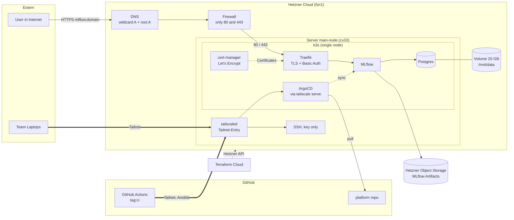

# infrastructure

Server infrastructure for the MarKRITIS project, which trains and documents a TorchRL policy for a 2D defense scenario. This repo provisions the server and bootstraps the Kubernetes cluster. Workloads live in the [platform](https://github.com/Project-MarKRITIS/platform) repo.

## Overview

| Layer | Tool | Purpose |
|-------|------|---------|
| Provisioning | Terraform (Terraform Cloud backend) | Hetzner server, network, firewall, volume, DNS |
| Configuration | Ansible | Hardening, volume mount, k3s, ArgoCD, secrets |
| Access | Tailscale | Private SSH and admin access |
| CI/CD | GitHub Actions | Runs Ansible over the tailnet |




## Structure

```
terraform/   Hetzner resources (server, firewall, network, volume, DNS)
ansible/     Playbooks and inventory
.github/     Ansible deploy workflow
```

## Architecture

- One Hetzner server (`cx33`, Ubuntu 24.04, `fsn1`) running single-node k3s
- 20 GB volume mounted at `/mnt/data`, used by the local-path provisioner for persistent volumes
- Firewall only allows inbound 80 and 443. SSH and admin access go through Tailscale
- Wildcard and root A records point to the server
- Cloud-init (`bootstrap.sh.tpl`) installs Tailscale on first boot

## Provisioning (Terraform)

Terraform runs in Terraform Cloud (workspace `infrastructure`).

Required variables:

| Variable | Description |
|----------|-------------|
| `HCLOUD_TOKEN` | Hetzner Cloud API token |
| `DOMAIN_ID` | Hetzner DNS zone ID |
| `TAILSCALE_AUTH_KEY_MASTER` | Tailscale auth key for the server |
| `TAILSCALE_MASTER_HOSTNAME` | Tailscale hostname of the server |

SSH keys are picked up from Hetzner by label (`role=team-access`, `role=ci`).

## Configuration (Ansible)

`ansible/site.yml` runs these playbooks in order:

1. `hardening.yml`: apt upgrade, unattended-upgrades, timezone, SSH key-only login
2. `mount_volume.yml`: mounts the data volume at `/mnt/data`
3. `k3s.yml`: installs k3s, fetches kubeconfig, points local-path storage to `/mnt/data`
4. `argocd.yml`: installs ArgoCD, exposes it via `tailscale serve`, applies the root app from the platform repo
5. `k3s-secrets.yml`: creates secrets and configmaps the platform needs (ARC, MLflow)

The inventory connects via `main-node.<TAILNET_DOMAIN>`.

## CI/CD

`.github/workflows/ansible-deploy.yml`:

- Pull request touching `ansible/**`: `ansible-playbook --check --diff`
- Push to `main`: full `ansible-playbook site.yml`
- Manual run via `workflow_dispatch`

The runner joins the tailnet with `tag:ci` and reads the data volume device from the Terraform Cloud outputs.

### GitHub secrets and variables

| Name | Type |
|------|------|
| `TAILNET_DOMAIN`, `TAILSCALE_AUTH_KEY_CI`, `CI_SSH_PRIVKEY` | secret |
| `TFC_TOKEN`, `TFC_WORKSPACE_ID` | secret |
| `GH_APP_ID`, `GH_APP_INSTALLATION_ID`, `GH_APP_PRIVATE_KEY` | secret |
| `POSTGRES_USER`, `POSTGRES_PASSWORD` | secret |
| `S3_ACCESS_KEY`, `S3_SECRET_KEY` | secret |
| `MLFLOW_BASIC_AUTH_USER`, `MLFLOW_BASIC_AUTH_PASSWORD` | secret |
| `PROJ_SERVER_DOMAIN` | variable |

## Bootstrapping from scratch

1. Apply Terraform in Terraform Cloud
2. Wait for the server to appear in the tailnet
3. Push to `main` (or run the workflow manually) to run Ansible
4. ArgoCD syncs the platform repo automatically